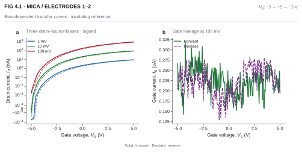
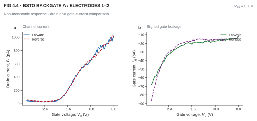
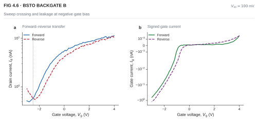
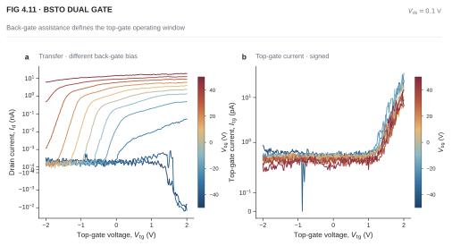
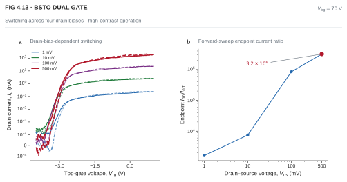
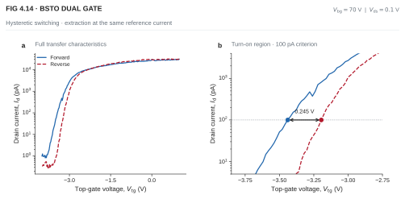

# MoS₂/BSTO Dual-Gate Field-Effect Transistors

**NTU Final Year Project · Zhang Jinming · Supervisor: Prof. Zheng Liu**

This project investigates van der Waals integration of CVD-grown monolayer MoS₂ with exfoliated mica and nominal Ba₀.₆Sr₀.₄TiO₃ (BSTO) gate dielectrics. I fabricated and electrically characterized a mica back-gated reference, two independently fabricated BSTO back-gated devices, and a BSTO/MoS₂ dual-gated transistor.

My work covered materials preparation and transfer, electrode design, electron-beam lithography, Cr/Au deposition and lift-off, followed by transfer/output measurements and simultaneous gate-current analysis.

## Selected results

| Device / metric | Measurement conditions | Result |
| --- | --- | --- |
| Mica reference: drain-current modulation | Vds = 0.1 V; Vg from −5 to +5 V | Id increased from approximately 1.77 pA to 0.944 μA, a measured endpoint change of **5.3 × 10⁵** |
| Dual gate: switching endpoint current ratio | Vbg = 70 V; Vds = 0.5 V; forward Vtg sweep from −4 to +1 V | Approximately 0.061 pA to 194 nA, giving **3.2 × 10⁶** between the specified sweep endpoints |
| Dual gate: hysteresis width | Vbg = 70 V; Vds = 0.1 V; Id,ref = 100 pA | Approximately **0.25 V**, extracted between forward and reverse top-gate sweeps |

The current ratios describe measured sweep endpoints. Sub-picoampere off-state readings make the ratios sensitive to the measurement floor. The hysteresis width is a separate, current-criterion-dependent measurement.

## Device architectures

| Configuration | Gate arrangement | Purpose |
| --- | --- | --- |
| Mica back gate | Local metal gate beneath mica, with MoS₂ above the dielectric | Insulating reference and electrostatic-control comparison |
| BSTO Backgate A | Local metal gate beneath BSTO; multiple source–drain electrode pairs | Compare contact regions and leakage contributions |
| BSTO Backgate B | Independently assembled BSTO back-gated device | Examine sweep direction and drain-bias dependence |
| BSTO dual gate | Local Cr/Au top gate / BSTO / MoS₂ / SiO₂ / conductive-Si global back gate | Apply Vtg and Vbg independently and coordinate switching |

The dual-gated device combines a local BSTO top-gate stack with the silicon-substrate back gate. Both gates were used during characterization.

## Fabrication workflow

### 1. Material preparation

Monolayer MoS₂ was grown on SiO₂/Si by CVD in a dual-zone tube furnace, using sulfur at 180 °C, MoO₃ at 750 °C, and argon as the carrier gas. Mica and BSTO flakes were prepared by adhesive-tape-assisted mechanical exfoliation. Optical microscopy identified suitable regions for assembly.

| CVD-grown MoS₂ | Exfoliated mica | Exfoliated BSTO |
| :---: | :---: | :---: |
|  |  |  |

### 2. PDMS-assisted transfer and assembly

A transparent PDMS stamp supported optical alignment and controlled release. For the back-gated devices, the dielectric was placed over a pre-patterned bottom gate. Water-assisted interfacial delamination enabled MoS₂ pickup from the growth substrate, followed by dry stamping onto mica or BSTO.

For the dual-gated device, MoS₂ was first positioned on SiO₂/Si, and BSTO was transferred above the channel. This sequence left the conductive silicon available as the global back gate and provided the dielectric for a local top gate.

| Transfer platform | Optical alignment and release |
| :---: | :---: |
|  |  |

### 3. Electrode fabrication and process troubleshooting

Electrode patterns were designed in AutoCAD and defined by electron-beam lithography. Electron-beam evaporation deposited **Cr 5 nm / Au 50 nm**, followed by lift-off.

Early fabrication runs showed metal peeling during lift-off. I revised the electrode layout to widen narrow features and increase the contact area, then inspected the resulting patterns optically. This connected mask design and metal adhesion with the requirements of contacting transferred flakes.

| Peeling observed after lift-off | Revised electrode layout |
| :---: | :---: |
|  |  |

| Mica back-gated device | BSTO back-gated device | BSTO dual-gated device |
| :---: | :---: | :---: |
|  |  |  |

## Electrical characterization

A probe station connected to a Keysight semiconductor parameter analyzer supplied gate and drain–source biases. Transfer measurements recorded Id together with gate currents. Output sweeps examined conduction under fixed gate settings. The dual-gate measurements independently varied Vtg and Vbg.

### Mica reference: gate control and low leakage

At Vds = 0.1 V, the mica reference showed a 5.3 × 10⁵ drain-current change over Vg = −5 to +5 V. Gate leakage remained approximately 0.13–0.32 pA. At positive gate bias, drain current scaled approximately with drain bias over 1–100 mV.

*Mica reference, electrode pair 1–2. Transfer sweeps at Vds = 1, 10 and 100 mV, with gate-current measurements at 100 mV.*

### BSTO back gates: comparing drain and gate currents

BSTO Backgate A showed non-monotonic transfer responses and substantial gate current at negative gate bias. Different electrode pairs produced different responses. BSTO Backgate B showed sweep separation, trace crossings and a negative-bias upturn that became more prominent at lower drain bias.

Comparing Id and Ig, and repeating measurements at different Vds, helped distinguish channel conduction from leakage-related backgrounds. Contact resistance and local channel variation were considered when comparing electrode pairs.

| BSTO Backgate A | BSTO Backgate B |
| :---: | :---: |
|  |  |

*Both measurements used Vds = 0.1 V. Device A was swept from −3 to 0 V and back; device B from −3 to +4 V and back.*

### Coordinated dual-gate control

Increasing positive back-gate bias shifted the top-gate turn-on range towards more negative voltages. The back gate established the operating condition, while the local top gate controlled switching within that condition. Strong positive or negative back-gate bias could keep the channel conductive or depleted throughout a limited top-gate sweep, showing why the biases must be coordinated.

*Vds = 0.1 V; Vbg from −50 to +50 V; Vtg swept from −2 to +2 V. The corresponding top-gate current is shown alongside the transfer curves.*

### Switching and sweep-history dependence

With Vbg = 70 V, extending the top-gate sweep to −4 V allowed channel depletion. The forward-sweep endpoint current ratio reached approximately 3.2 × 10⁶ at Vds = 0.5 V. Gate-controlled switching was also observed at lower drain biases, with smaller conducting-state currents.

*Vbg = 70 V; Vtg swept from −4 to +1 V and back; Vds = 1, 10, 100 and 500 mV.*

A separate measurement at Vds = 0.1 V gave a hysteresis width of approximately 0.25 V at Id = 100 pA. The separation varied with the reference current. This quantifies sweep-history-dependent conduction in the BSTO/MoS₂ gate stack; polarization-related electrostatics and charge trapping are relevant to its physical interpretation.

*Vbg = 70 V; Vds = 0.1 V. Forward/reverse separation is extracted at the same drain current.*

## Research contribution

This work demonstrates assembly and operation of BSTO/MoS₂ dual-gated transistors and shows how gate architecture, contact behaviour and leakage influence the measured response. It developed my experience connecting fabrication choices with electrical data and interpreting low-current measurements using simultaneous gate-current monitoring.

**Report:** *Van der Waals Integration of Perovskite Ferroelectric Ba₀.₆Sr₀.₄TiO₃ with 2D MoS₂ for High-Performance Dual-Gate Field-Effect Transistors* (NTU FYP, 2026).

**Related work:** [SJTU silicon photonics, graphene heaters and microring experiments](https://github.com/m220115-prog/NTU-SJTU-SILICON-PHOTONICS-2D-MODULATOR).

